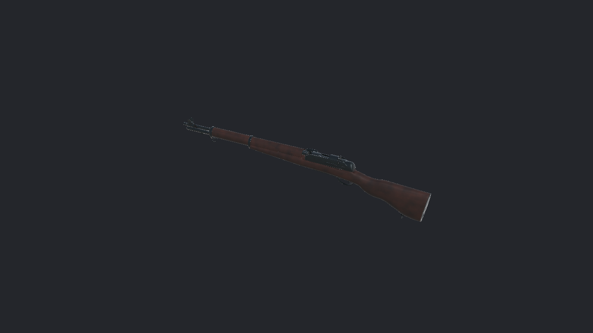
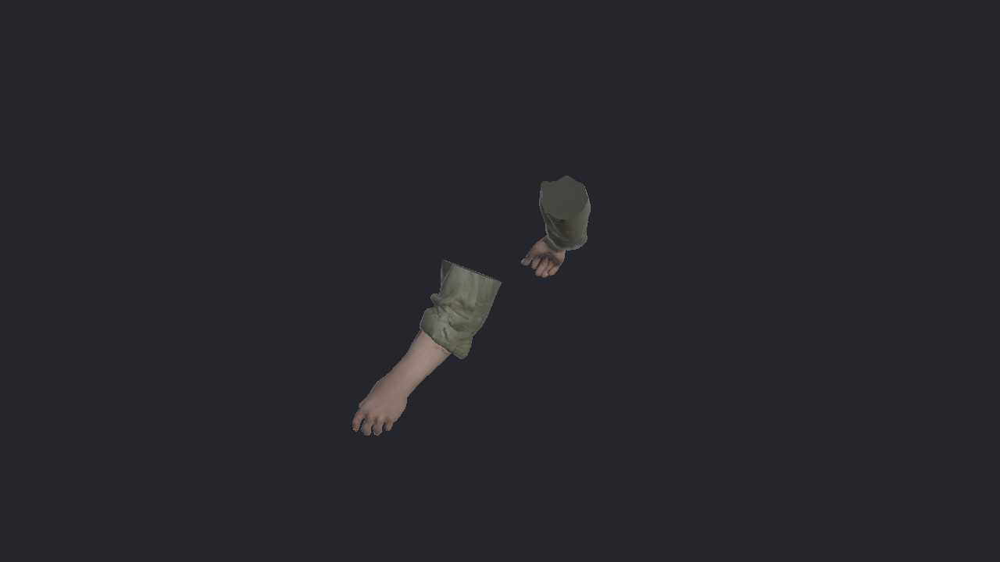
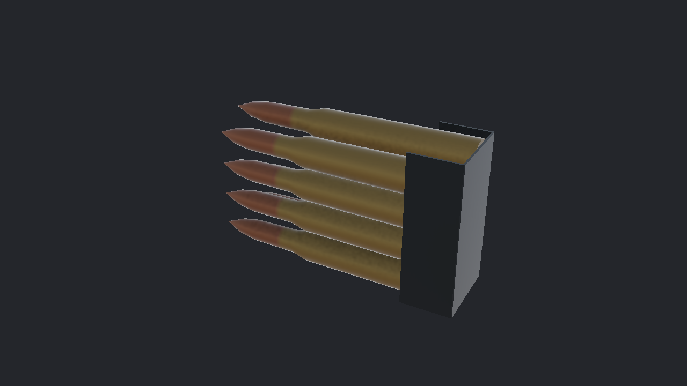
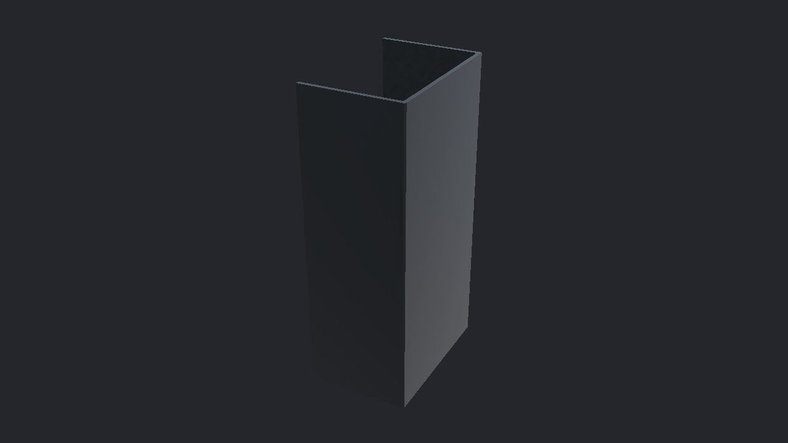
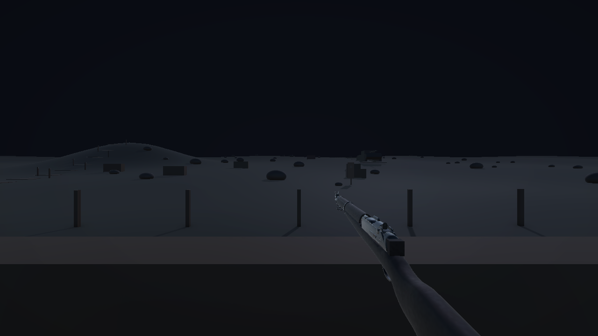

# ART_SPEC 작업 체크리스트

**2026-10-28 · 팀 저장소 `fiveriver/art` · Unity 6000.3.25f1 / URP 17.3.0**

> 에셋 임포트·정적 표시 검증 완료. 게임의 팔 연결·파지·조준·장전 최종 통합은 아직 완료가 아닙니다.

| 항목 | 이번 프로젝트 확인 결과 | 상태 |
|---|---|---|
| 5 · `SK_CH_ROK_Arms` | 6,534삼각형, 유효 Humanoid, 65본, 2K 피부·소매 텍스처, 실제 스킨 메시 정적 표시 | ✅ 임포트 확인 |
| 6 · `SM_WP_M1Garand` | 1.10m, 14,924삼각형, Body·Bolt·ClipSlot, 목재·금속 2K 연결 | ✅ 임포트 확인 |
| 7 · `SM_WP_M1Garand_Clip` | 988삼각형, 탄 포함 83.21mm. 강철·황동 재질 매핑 수정 후 2K 맵 3종 연결 | ✅ 수정·재검사 |
| 8 · `SM_WP_M1Garand_ClipEmpty` | 44삼각형, 금속 길이 48.90mm, 탄 없는 형상·금속 재질 표시 | ✅ 임포트 확인 |

## 이번에 완료한 확인

- [x] M1·M3·M5·M6·M7 — 지정 이름·폴더, 크기·방향·스케일 1, 삼각형 수 확인.
- [x] M11·M12·W1 — 네 모델의 재질 누락 0, URP Lit 지원, BaseColor·Normal·MetallicSmoothness 모두 2048×2048.
- [x] 장전 클립 — 내부 임시 재질 대신 `Art/Materials/M_WP_M1_Clip.mat`과 `M_WP_M1_Brass.mat`에 연결. 기존 FBX GUID 유지.
- [x] M15 중 참조 검사 — 기존 프리팹 19개와 `Dabudong.unity`의 검사한 참조 Missing 0. null 메시도 별도 검사.
- [x] C3 — 팔의 Humanoid Avatar 유효, 손가락 포함 65본 확인. `Walk_Validation` 클립 30fps / 2.733초 임포트 확인.
- [x] 기존 `ArtSpecTests` 15개 모두 통과. 테스트만으로 텍스처 연결을 판단하지 않고 별도 실제 재질 검사 병행.
- [x] 4개 에셋 정적 이미지와 편집 모드 게임 카메라 화면 확인. Astra 독립 시각 검수 완료.

## 아직 완료하지 않은 작업

- [ ] 게임에 팔 연결 — 현재 `Dabudong` 씬의 해당 팔 SkinnedMeshRenderer 수는 0. 에셋 파일 납품과 게임 연결은 별개.
- [ ] 기존 임시 `RearSight`·`FrontSight` 정리, 실제 M1 형상에 맞춘 총구·클립 배출 소켓 정합 확인.
- [ ] 현재 게임의 손 파지·ADS·8발 사격·장전·클립 배출을 실행 빌드에서 확인.
- [ ] C2 — Configure Avatar의 초록색 매핑 UI 직접 확인.
- [ ] C6 — 이번 프로젝트에서 Walk 83프레임을 실제 재생해 변형 확인. 클립 임포트 확인으로 대체하지 않음.
- [ ] ROK_Soldier와 소매 색·재질 비교, 내부 장전 클립 맞물림 확인.
- [ ] M14 — 이번 게임 야간 플레이 가시성 확인. 편집 모드 카메라 캡처는 야간 플레이 합격 증거가 아님.
- [ ] M16 — 콘솔 경고 0. 검사 시 오류 0 / 경고 2: 팔 애니메이션 임포트 경고 1개, Unity AI Account API 대기 경고 1개. 콘솔을 지우지 않고 기록.
- [ ] 다른 캐릭터·맵·전차·추가 VFX·UI 등 이번 범위 밖 항목.

## 실제 임포트 이미지

## 이전 검수와의 구분

2026-10-27 전달 ZIP은 별도 Unity 6000.6.0f1 / URP 17.6.0에서 파지·ADS·사격·장전·보행을 검수한 버전입니다. 그 결과를 이번 게임의 미완료 항목에 자동 승계하지 않았습니다. 이전에 수용한 오른손 약 0.014mm의 미세 접촉과 내부 정합 미확인 범위도 유지합니다.

팔 이미지는 검수용 복제본에서 Animator를 끄고 SkinnedMeshRenderer의 화면 밖 갱신을 켜 실제 스킨 메시로 렌더했습니다. 정적 표면 확인용이며 런타임 파지·애니메이션 검증을 대신하지 않습니다. 원본 에셋에 해당 설정을 저장하지 않았습니다.

실측 결과: [UNITY_VERIFICATION.json](UNITY_VERIFICATION.json) · [통합 안내](README.md)
