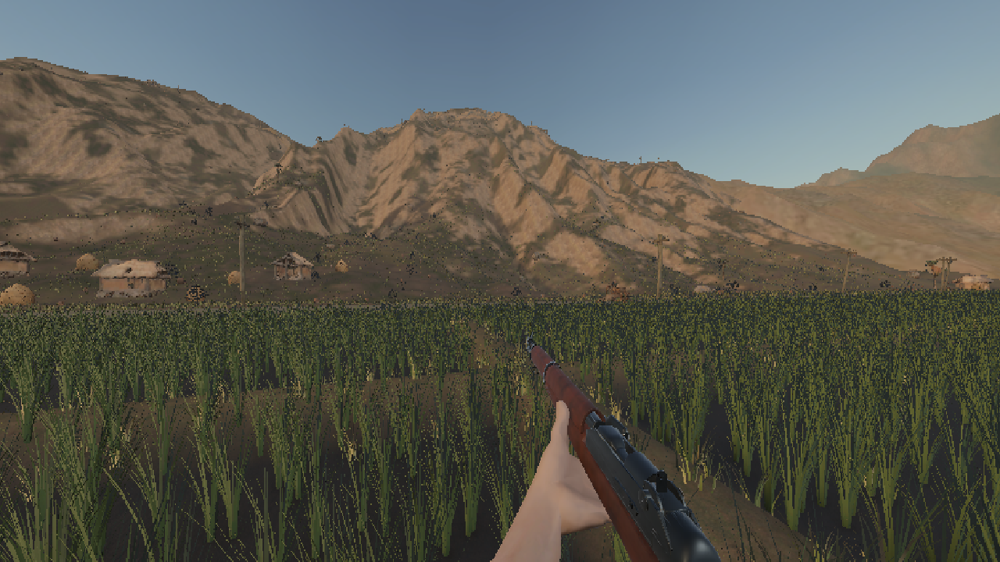
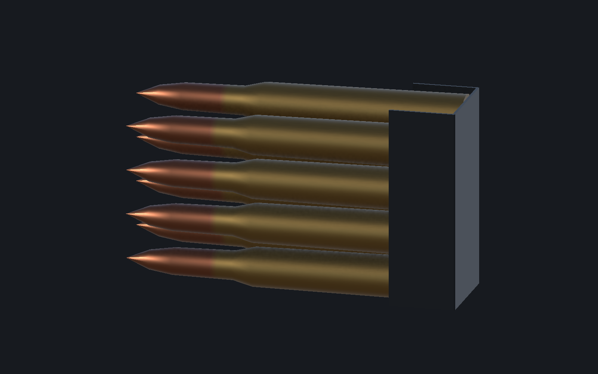

# ART_SPEC 작업 완료 체크리스트

2026-10-27 · GPT-6.1 Sol 수정 / Astra 독립 검수

**수정한 5~8번 에셋은 전달 가능 판정입니다. 전체 ART_SPEC 완료와는 구분합니다.**

| ART_SPEC 항목 | 결과 | 실제 완료 범위 |
|---|---|---|
| 5 · 1인칭 팔 | ✅ 제작·사용 검수 | 6,534삼각형 / 65본 / 피부·손톱·소매 2K. 기준 자세 오류 수정, M1·바주카 표시, 보행 83프레임 확인. |
| 6 · M1 개런드 | ✅ 제작·사용 검수 | 1.10m / 14,924삼각형. Body·Bolt 분리, ClipSlot 소켓 연결, 좌우 반전 수정. 조준·8발 사격·장전·볼트 왕복 확인. |
| 7 · 장전 클립 | ✅ 제작·배치 검수 | 8발 / 988삼각형. 황동·탄두·강철 구분, 소켓 배치와 장전 연결 확인. 탄 포함 83.21mm. |
| 8 · 빈 클립 | ✅ 제작·연결 검수 | 탄 없는 금속 클립 / 44삼각형. 배출 연결 확인. 금속 클립 길이 48.90mm. |

## 검증 완료

- [x] M3·M5·M6·M7 — 실제 Unity에서 크기·방향·스케일·삼각형 예산 확인.
- [x] M11·M12·W1 — 주간 실제 재질·2K 텍스처 연결, 깨진 분홍 재질 없음.
- [x] M15 — 다른 Unity 프로젝트에 필수 56파일을 옮긴 뒤 4프리팹 생성·참조·팔 초기화 확인.
- [x] C3 — 유효 Humanoid와 손가락 매핑 30개 확인.
- [x] C6 중 팔 범위 — 실제 보행 83프레임에서 양팔 삼각 교차·정점 내포 0. 전신 옷 검수와 구분.
- [x] W2·W3 — M1 분리 부품·실물 비율·볼트 69.86mm 왕복/복귀 확인.
- [x] M14 중 팔·M1 범위 — 실제 주·야간 Hip/ADS 화면 확인.

## 남겨 둔 확인 항목

- [ ] 프로젝트 적용 — 기존 게임 컨트롤러에 팔 API 연결 후 최종 통합 확인. 이번에는 에셋만 전달하며 실제 게임 프로젝트 적용은 수행하지 않음.
- [ ] C2 — Configure Avatar의 초록색 UI 화면을 직접 확인하는 절차.
- [ ] 5번 추가 — ROK_Soldier와 소매 색·재질을 나란히 비교하는 절차.
- [ ] 6번 추가 — 가려지는 장전부 내부의 정밀 맞물림을 별도 확정하는 절차.
- [ ] M16 전체 — 보조 다리 본 스케일 채널의 Humanoid 재설정 경고가 기록되어 전체 이력 0으로 표시하지 않음. 마지막 실동작/수신 검사에서는 새 오류·경고 0.
- [ ] 이번 범위 밖 — 다른 캐릭터·맵·전차·추가 VFX·UI 항목.

## 접촉 검수 메모

오른손 중지·약지 패드와 총몸의 자연스러운 접촉면에 미세한 면 교차가 남습니다. 실제 9장면의 경계 평면 침범 상한은 약 0.014mm이고, 총 안에 들어간 정점은 0입니다. Astra가 가시 불량 없는 접촉으로 수용했습니다. 모든 순간의 교차가 0이라는 뜻은 아닙니다.

